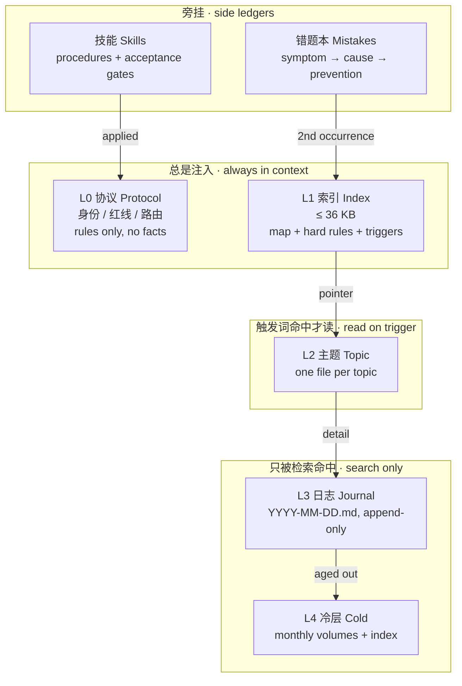

<p align="center">
  
</p>

<p align="center">
  <b>给长期运行的 Agent 一套不会腐烂的记忆结构</b><br>
  <i>A memory architecture for agents that live for months, not minutes.</i>
</p>

<p align="center">
  
  
  
  
</p>

---

## 一句话 · In one line

**中文** — 把记忆拆成 **协议层 / 索引层 / 主题层 / 日志层 / 冷层**，写入靠纪律，
读取走唯一检索入口，治理靠机械闸（hook 层 fail-closed），错误靠
**错题本 + 同型二次升级**不再重犯。

**English** — Split memory into **protocol / index / topic / journal / cold** layers.
Write by rule, read through one grep entry, govern with mechanical gates at the hook layer,
and stop repeating mistakes with an incident ledger plus a "second occurrence must become a
rule" escalation gate.

> 这套东西不是框架，是**约束**。它来自一个真实跑了数月、几百个任务、并持续出错的 Agent。
> This is not a framework. It is a set of constraints, extracted from an agent that ran for
> months, handled hundreds of tasks, and kept failing in the same ways.

---

## 它解决什么 · What it fixes

| 故障 | Symptom | 后果 · Cost |
|---|---|---|
| **注入预算撞墙** | memory shoved into the system prompt until no room is left | 任务本身没空间 · the task gets squeezed out |
| **记忆腐烂** | a three-week-old conclusion contradicts today's code | 按过期信息行动 · acting on stale truth |
| **错误重犯** | the same tool trap hit for the fifth time | 每次重新诊断 · re-diagnosing from scratch |
| **程序性知识散落** | the good procedure lives in one day's log | 下次从头再来 · starting over |
| **决策无凭** | nobody remembers why this trade-off was chosen | 同一个取舍讨论五遍 · re-litigating forever |

---

## 结构 · Architecture



| 层 Layer | 上限 Budget | 写入时机 When written | 读取方式 How read |
|---|---|---|---|
| L0 协议 | ~2 KB × 3 | 规则变化时 | 永远注入 |
| L1 索引 | 36 KB | 结论/规则/入口变化 | 永远注入 |
| L2 主题 | 40 KB / 文件 | 某主题有新结论 | 触发词命中 |
| L3 日志 | 只增不改 | 每完成一步 | 检索命中片段 |
| L4 冷层 | 36 KB / 卷 | 4 周未动 | 索引回溯 |

---

## 三条反直觉结论 · Three counter-intuitive findings

**1. 不用向量检索 · Skip embeddings.**
在资源受限的单机上全量重建一次向量索引，几百个文件跑了两小时，系统负载 5.7，
期间请求被挤掉。记忆总量只有几百 KB —— 重建成本远大于检索收益。
Rebuilding an embedding index over a few hundred files took about two hours on a
resource-constrained box and pushed load to 5.7. The corpus was only a few hundred KB.
grep + bigram is cheaper, explainable, and fails visibly.

**2. 预算先于内容 · Budget before content.**
先定「索引层 36 KB」，再决定什么值得写。反过来做，记忆会自然膨胀到把任务挤出去。
Decide the budget first, then decide what deserves to be written.

**3. 纪律必须变成闸 · Discipline must become a gate.**
写进文档的规则，模型迟早会忘。共享文件禁整写、配置只能收紧、同型错误必须升级 ——
全部下沉到 hook 层，未知情况一律拒绝。
Rules that live only in prose get forgotten. Put them in a fail-closed hook layer.

---

## 快速开始 · Quick start

```bash
git clone <repo-url> && cd longmem

# 1) 看一个带记忆的项目 · browse a synthetic memory root
ls examples/greenhouse

# 2) 用同一入口检索 · search it
python3 scripts/memory_search.py "丢包率 packet loss" \\
  --root examples/greenhouse --daily --daily-dir journal

# 3) 抄骨架 · copy the skeletons, then rename to your own convention
cp templates/index-template.md  ./my-agent/      # -> the always-injected index
cp templates/topic-template.md  ./my-agent/      # -> one file per topic
cp templates/mistakes.md        ./my-agent/      # -> incident ledger
```

无依赖，Python 3.8+ 标准库 · No dependencies, Python 3.8+ stdlib only.

输出示例 · Sample output:

```
0.825  memory-sensors.md   - 采样 1 Hz，CRC 重传 2 次，丢包率从 12% 降到 3%（2026-01-15）。
0.664  2026-01-15.md       - 10:20 丢包率 12% → 3%：试过换频段（无效）、加天线（无效）、CRC 重传（有效）。
0.147  memory-index.md     | memory-sensors.md | LoRa 采样、丢包、重传策略 |
```

主题层排在日志层之前，而不是最长文件霸榜 —— 这就是层级权重的意义。
The topic file outranks the journal, and neither is the longest document. That is the point
of tier weighting.

---

## 文档 · Documentation

| 文档 | 主题 |
|---|---|
| [docs/01-layers.md](docs/01-layers.md) | 五层模型与注入预算 · layers and budgets |
| [docs/02-write.md](docs/02-write.md) | 写入纪律与大文件安全 · write safety |
| [docs/03-retrieval.md](docs/03-retrieval.md) | 检索打分与不用向量的理由 · retrieval |
| [docs/04-mistakes.md](docs/04-mistakes.md) | 错题本与升级门 · incident ledger |
| [docs/05-skills.md](docs/05-skills.md) | 程序性记忆 · procedural memory |
| [docs/06-governance.md](docs/06-governance.md) | 台账、收件箱、机械闸 · governance |

每篇文档中文在前、英文在后（文件末尾的 `## English` 段）。
Every doc is bilingual: Chinese first, English section at the end.

---

## 目录结构 · Repository layout

```
README.md            这份文件 · this file
docs/                设计说明，双语 · bilingual design notes
templates/           可直接抄的骨架 · copy-paste skeletons
examples/greenhouse/ 虚构记忆库，可跑 · synthetic memory root
scripts/             最小检索实现 · minimal retrieval
assets/              banner
```

---

## 不适合谁 · Not for everyone

- **需要语义召回的场景** —— 本方案刻意放弃 embedding，见 docs/03。
  *Cases that need semantic recall.*
- **单人短周期项目** —— 三层就够，五层是给跑几个月、跨几十个任务的场景。
  *Short solo projects: three layers is enough.*
- **想要开箱即用 SDK 的人** —— 这里给的是约束与方法。
  *People who want an SDK.*

---

## 许可 · License

文档遵循 CC BY 4.0，代码遵循 MIT。
Docs under CC BY 4.0, code under MIT.
