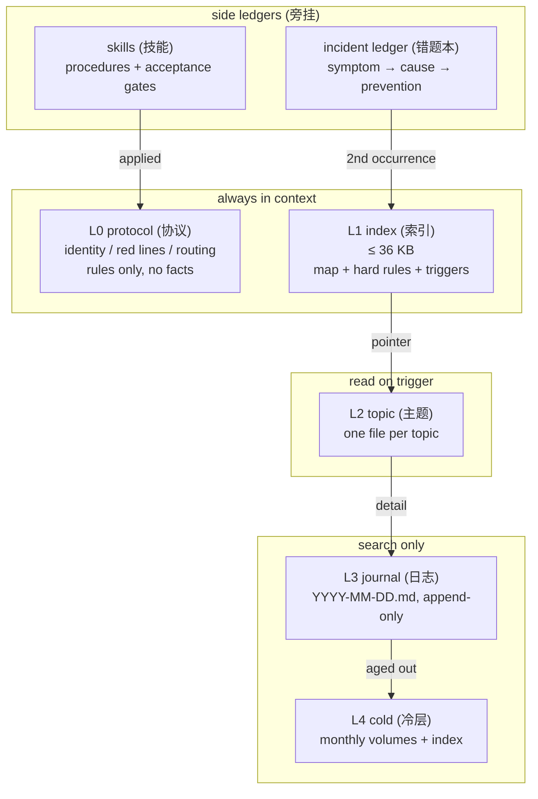

<p align="center">
  
</p>

<p align="center">
  <b>A memory architecture for agents that live for months, not minutes.</b><br>
  <i>给长期运行的 Agent 一套不会腐烂的记忆结构</i>
</p>

<p align="center">
  
  
  
  
</p>

Companion repo: [harness-governance](https://github.com/SquareXRay/harness-governance) — the execution and governance side.

**中文**

配套仓库：[harness-governance](https://github.com/SquareXRay/harness-governance) —— 负责执行与治理的那一侧。

---

## In one line

Split memory into **protocol / index / topic / journal / cold** layers. Write by rule, read
through one grep entry, govern with mechanical gates at the hook layer, and stop repeating
mistakes with an incident ledger plus a "second occurrence must become a rule" escalation gate.

> This is not a framework. It is a set of constraints, extracted from an agent that ran for
> months, handled hundreds of tasks, and kept failing in the same ways.

**中文**

把记忆拆成 **协议 / 索引 / 主题 / 日志 / 冷层** 五层。按规则写入，读取只走一个 grep 入口，治理靠 hook 层的机械闸，并用错题本（incident ledger）加「同型第 2 次必须升级为规则」的升级门（escalation gate）止住重复犯错。

> 这不是一个框架。它是一组约束，取自一个跑了几个月的 agent —— 它处理过几百个任务，并且一直在同样的地方栽跟头。

---

## What it fixes

| Symptom | Cost |
|---|---|
| **Injection budget exhausted** — memory shoved into the system prompt until no room is left | the task itself gets squeezed out |
| **Memory rot** — a three-week-old conclusion contradicts today's code | acting on stale truth |
| **Repeated failure** — the same tool trap hit for the fifth time | re-diagnosing from scratch |
| **Scattered procedural knowledge** — the good procedure lives in one day's log | starting over next time |
| **Decisions without provenance** — nobody remembers why this trade-off was chosen | re-litigating the same choice forever |

**中文**

| 症状 | 代价 |
|---|---|
| **注入预算被吃光** —— 记忆被硬塞进系统提示，直到一点空间都不剩 | 任务本身被挤出去 |
| **记忆腐烂** —— 三周前的结论和今天的代码打架 | 照着过期的真相行动 |
| **重复失败** —— 同一个工具坑踩到第五次 | 每次都要从头再诊断一遍 |
| **流程知识散落** —— 好用的流程只活在某一日的日志里 | 下次重新来过 |
| **决策没有出处** —— 没人记得这个取舍当初为什么这么定 | 同一个选择永远反复吵 |

---

## Architecture



| Layer | Budget | When written | How read |
|---|---|---|---|
| L0 protocol | ~2 KB × 3 | when a rule changes | always injected |
| L1 index | 36 KB | conclusions, rules or entry points change | always injected |
| L2 topic | 40 KB per file | a topic gains a new conclusion | trigger word hit |
| L3 journal | append-only | after every completed step | matching search snippet |
| L4 cold | 36 KB per volume | untouched for 4 weeks | index lookup |

**中文**

上图与下表是同一件事的文字说明：L0 协议 / L1 索引常驻上下文，L2 主题触发时才读，L3 日志 / L4 冷层只做检索；错题本与技能作为旁挂台账挂在侧面（错题本第 2 次命中时回灌 L1，技能被应用时回灌 L0）。

| 层级 | 预算 | 何时写入 | 怎么读 |
|---|---|---|---|
| L0 协议 | ~2 KB × 3 | 规则变化时 | 始终注入 |
| L1 索引 | 36 KB | 结论、规则或入口变化时 | 始终注入 |
| L2 主题 | 每文件 40 KB | 某个主题得到新结论时 | 触发词命中 |
| L3 日志 | 只追加 | 每完成一步之后 | 匹配的检索片段 |
| L4 冷层 | 每卷 36 KB | 四周未被触碰 | 查索引 |

---

## Three counter-intuitive findings

**1. Skip embeddings.**
Rebuilding an embedding index over a few hundred files took about two hours on a
resource-constrained box and pushed load to 5.7; requests were starved while it ran. The whole
corpus was only a few hundred KB — the rebuild cost far exceeds the retrieval benefit.
grep + bigram is cheaper, explainable, and fails visibly.

**2. Budget before content.**
Fix the index budget — 36 KB — first, then decide what deserves to be written. Do it the other
way round and memory grows until it crowds the task out.

**3. Discipline must become a gate.**
Rules that live only in prose get forgotten by the model sooner or later. Whole-file writes on
shared files, config changes that widen scope, repeat mistakes that never escalate — all of it
sinks into a hook layer that rejects unknown cases by default.

**中文**

**1. 跳过向量检索。**
在资源受限的机器上，为几百个文件重建一次向量索引要花约两小时，还把负载顶到 5.7；它跑的时候，请求全被饿死。整个语料不过几百 KB —— 重建成本远远超过检索收益。grep + bigram 更便宜、可解释，而且失败是看得见的。

**2. 预算先于内容。**
先定死索引预算 —— 36 KB —— 再决定什么值得写。反过来做，记忆会一路长，直到把任务挤出去。

**3. 纪律必须变成一个闸。**
只活在正文里的规则，模型迟早会忘。共享文件上的整文件写入、放宽范围的配置改动、从不升级的重复错误 —— 全部沉到 hook 层，未知情况默认拒绝。

---

## Quick start

```bash
git clone <repo-url> && cd longmem

# 1) browse a synthetic memory root
ls examples/greenhouse

# 2) search it through the single entry point
python3 scripts/memory_search.py "丢包率 packet loss" \
  --root examples/greenhouse --daily --daily-dir journal

# 3) copy the skeletons, then rename to your own convention
cp templates/index-template.md  ./my-agent/      # -> the always-injected index
cp templates/topic-template.md  ./my-agent/      # -> one file per topic
cp templates/mistakes.md        ./my-agent/      # -> incident ledger
```

No dependencies, Python 3.8+ stdlib only.

Sample output (query: "丢包率 packet loss", root `examples/greenhouse`):

```
0.825  memory-sensors.md   - 采样 1 Hz，CRC 重传 2 次，丢包率从 12% 降到 3%（2026-01-15）。
0.664  2026-01-15.md       - 10:20 丢包率 12% → 3%：试过换频段（无效）、加天线（无效）、CRC 重传（有效）。
0.147  memory-index.md     | memory-sensors.md | LoRa 采样、丢包、重传策略 |
```

The quoted lines are the tool's output over a Chinese-language corpus, left verbatim on purpose.
The topic file outranks the journal, and neither is the longest document — that is the point of
tier weighting.

**中文**

零依赖，只用 Python 3.8+ 标准库。

示例输出（查询：「丢包率 packet loss」，根目录 `examples/greenhouse`）：

引号里那几行是工具在中文语料上的真实输出，故意原样保留。主题文件排在日志前面，而两者都不是最长的文档 —— 这正是层级权重的意义。

---

## Documentation

| Doc | Topic |
|---|---|
| [docs/01-layers.md](docs/01-layers.md) | the five layers and injection budgets |
| [docs/02-write.md](docs/02-write.md) | write discipline and large-file safety |
| [docs/03-retrieval.md](docs/03-retrieval.md) | retrieval scoring, and why not embeddings |
| [docs/04-mistakes.md](docs/04-mistakes.md) | the incident ledger and the escalation gate |
| [docs/05-skills.md](docs/05-skills.md) | procedural memory |
| [docs/06-governance.md](docs/06-governance.md) | ledgers, inbox, mechanical gates |

Every doc pairs each section with a full Chinese translation right after it.

**中文**

| 文档 | 主题 |
|---|---|
| [docs/01-layers.md](docs/01-layers.md) | 五层模型与注入预算 |
| [docs/02-write.md](docs/02-write.md) | 写入纪律与大文件安全 |
| [docs/03-retrieval.md](docs/03-retrieval.md) | 检索打分，以及为什么不用向量 |
| [docs/04-mistakes.md](docs/04-mistakes.md) | 错题本与升级门 |
| [docs/05-skills.md](docs/05-skills.md) | 程序记忆 |
| [docs/06-governance.md](docs/06-governance.md) | 决策台账、收件箱、机械闸 |

每篇文档的每个小节都紧跟完整的中文对照。

---

## Repository layout

```
README.md            this file
docs/                bilingual design notes, per-section EN/ZH parallel text
templates/           copy-paste skeletons
examples/greenhouse/ synthetic memory root, runnable
scripts/             minimal retrieval implementation
assets/              banner
```

**中文**

目录结构同上方代码块，逐行对应：`README.md` 就是本文件；`docs/` 放逐节中英对照的设计说明（每节英文后紧跟中文全文）；`templates/` 放可复制的骨架；`examples/greenhouse/` 是一个合成的记忆根，可以直接跑；`scripts/` 是最小检索实现；`assets/` 放横幅图。

---

## Not for everyone

- **Cases that need semantic recall** — this design gives up embeddings on purpose, see docs/03.
- **Short solo projects** — three layers are enough; five are for work that runs for months
  across dozens of tasks.
- **People who want a ready-made SDK** — what you get here is constraints and method.

**中文**

- **需要语义召回的场合** —— 这个设计是有意放弃向量的，见 docs/03。
- **短期单人项目** —— 三层就够了；五层是给跨几十个任务、要跑几个月的工作用的。
- **想要一个开箱即用 SDK 的人** —— 这里给的是约束和方法。

---

## License

Docs under CC BY 4.0, code under MIT.

**中文**

文档采用 CC BY 4.0，代码采用 MIT。

