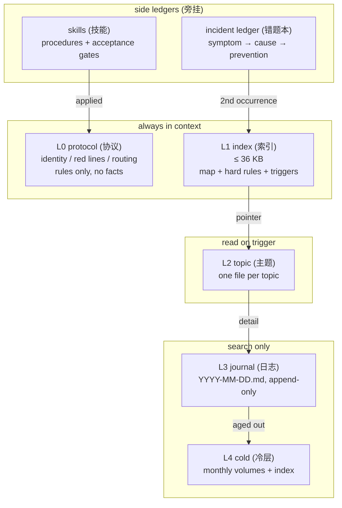

<p align="center">
  
</p>

<p align="center">
  <b>A memory architecture for agents that live for months, not minutes.</b><br>
  <i>给长期运行的 Agent 一套不会腐烂的记忆结构</i>
</p>

<p align="center">
  
  
  
  
</p>

Companion repo: [harness-governance](https://github.com/SquareXRay/harness-governance) — the execution and governance side.

---

## In one line

Split memory into **protocol / index / topic / journal / cold** layers. Write by rule, read
through one grep entry, govern with mechanical gates at the hook layer, and stop repeating
mistakes with an incident ledger plus a "second occurrence must become a rule" escalation gate.

> This is not a framework. It is a set of constraints, extracted from an agent that ran for
> months, handled hundreds of tasks, and kept failing in the same ways.

---

## What it fixes

| Symptom | Cost |
|---|---|
| **Injection budget exhausted** — memory shoved into the system prompt until no room is left | the task itself gets squeezed out |
| **Memory rot** — a three-week-old conclusion contradicts today's code | acting on stale truth |
| **Repeated failure** — the same tool trap hit for the fifth time | re-diagnosing from scratch |
| **Scattered procedural knowledge** — the good procedure lives in one day's log | starting over next time |
| **Decisions without provenance** — nobody remembers why this trade-off was chosen | re-litigating the same choice forever |

---

## Architecture



| Layer | Budget | When written | How read |
|---|---|---|---|
| L0 protocol | ~2 KB × 3 | when a rule changes | always injected |
| L1 index | 36 KB | conclusions, rules or entry points change | always injected |
| L2 topic | 40 KB per file | a topic gains a new conclusion | trigger word hit |
| L3 journal | append-only | after every completed step | matching search snippet |
| L4 cold | 36 KB per volume | untouched for 4 weeks | index lookup |

---

## Three counter-intuitive findings

**1. Skip embeddings.**
Rebuilding an embedding index over a few hundred files took about two hours on a
resource-constrained box and pushed load to 5.7; requests were starved while it ran. The whole
corpus was only a few hundred KB — the rebuild cost far exceeds the retrieval benefit.
grep + bigram is cheaper, explainable, and fails visibly.

**2. Budget before content.**
Fix the index budget — 36 KB — first, then decide what deserves to be written. Do it the other
way round and memory grows until it crowds the task out.

**3. Discipline must become a gate.**
Rules that live only in prose get forgotten by the model sooner or later. Whole-file writes on
shared files, config changes that widen scope, repeat mistakes that never escalate — all of it
sinks into a hook layer that rejects unknown cases by default.

---

## Quick start

```bash
git clone <repo-url> && cd longmem

# 1) browse a synthetic memory root
ls examples/greenhouse

# 2) search it through the single entry point
python3 scripts/memory_search.py "丢包率 packet loss" \
  --root examples/greenhouse --daily --daily-dir journal

# 3) copy the skeletons, then rename to your own convention
cp templates/index-template.md  ./my-agent/      # -> the always-injected index
cp templates/topic-template.md  ./my-agent/      # -> one file per topic
cp templates/mistakes.md        ./my-agent/      # -> incident ledger
```

No dependencies, Python 3.8+ stdlib only.

Sample output (query: "丢包率 packet loss", root `examples/greenhouse`):

```
0.825  memory-sensors.md   - 采样 1 Hz，CRC 重传 2 次，丢包率从 12% 降到 3%（2026-01-15）。
0.664  2026-01-15.md       - 10:20 丢包率 12% → 3%：试过换频段（无效）、加天线（无效）、CRC 重传（有效）。
0.147  memory-index.md     | memory-sensors.md | LoRa 采样、丢包、重传策略 |
```

The quoted lines are the tool's output over a Chinese-language corpus, left verbatim on purpose.
The topic file outranks the journal, and neither is the longest document — that is the point of
tier weighting.

---

## Documentation

| Doc | Topic |
|---|---|
| [docs/01-layers.md](docs/01-layers.md) | the five layers and injection budgets |
| [docs/02-write.md](docs/02-write.md) | write discipline and large-file safety |
| [docs/03-retrieval.md](docs/03-retrieval.md) | retrieval scoring, and why not embeddings |
| [docs/04-mistakes.md](docs/04-mistakes.md) | the incident ledger and the escalation gate |
| [docs/05-skills.md](docs/05-skills.md) | procedural memory |
| [docs/06-governance.md](docs/06-governance.md) | ledgers, inbox, mechanical gates |

Every doc is English-first and ends with a `## 中文摘要` section.

---

## Repository layout

```
README.md            this file
docs/                English-first design notes, Chinese summary at the end
templates/           copy-paste skeletons
examples/greenhouse/ synthetic memory root, runnable
scripts/             minimal retrieval implementation
assets/              banner
```

---

## Not for everyone

- **Cases that need semantic recall** — this design gives up embeddings on purpose, see docs/03.
- **Short solo projects** — three layers are enough; five are for work that runs for months
  across dozens of tasks.
- **People who want a ready-made SDK** — what you get here is constraints and method.

---

## License

Docs under CC BY 4.0, code under MIT.

---

## 中文摘要

- 一句话：把记忆拆成 **协议 / 索引 / 主题 / 日志 / 冷层**，写入靠纪律，读取走唯一检索入口，治理靠 hook 层的机械闸（fail-closed），错误靠错题本 + 「同型第 2 次要升级为规则」止住。
- 三条反直觉结论：不用向量检索（重建成本远大于检索收益）、预算先于内容、纪律必须落成闸而不是写在文档里。
- 结构表自下而上：L0 常驻、L1 常驻、L2 触发词命中、L3 只检索、L4 按需回溯；日志是唯一允许啰嗦的层。
- 快速开始：抄 `templates/` 三个骨架，用 `scripts/memory_search.py` 在 `examples/greenhouse` 上试检索。
- 本仓文档统一英文正文在前，末尾附中文摘要；配套的执行与治理侧在 harness-governance。
